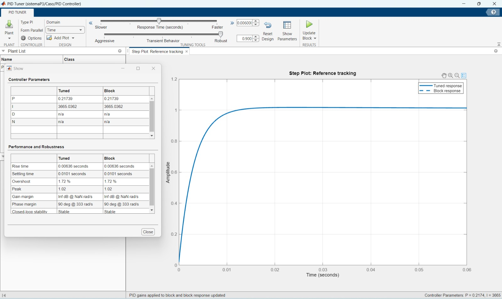
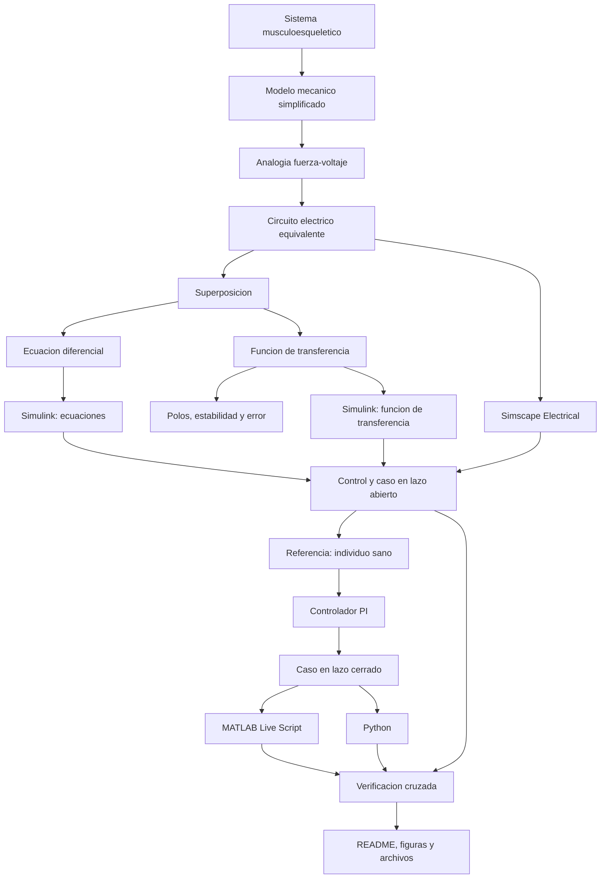

[](https://matlab.mathworks.com/open/github/v1?repo=l23212239/MSFP3)
# Práctica 3 — Modelado y control del sistema musculoesquelético

Repositorio académico de la asignatura **Modelado de Sistemas Fisiológicos**, correspondiente al programa de **Ingeniería Biomédica** del Tecnológico Nacional de México / Instituto Tecnológico de Tijuana. Esta práctica integra modelado mecánico, analogía electromecánica, formulación matemática, análisis temporal y de estabilidad, control clásico y verificación computacional.

El caso de estudio representa un compartimento musculoesquelético mediante un elemento contráctil, un componente viscoso y dos elementos elásticos. Se compara la respuesta de un individuo sano (**control**) con un caso simplificado de atrofia muscular (**caso**) y se utiliza la respuesta sana como referencia para un controlador en lazo cerrado.

**Docente:** Dr. Paul Antonio Valle Trujillo  
**Correo:** paul.valle@tectijuana.edu.mx  
**Departamento:** Ingeniería Eléctrica y Electrónica  
**Institución:** Tecnológico Nacional de México / Instituto Tecnológico de Tijuana  
**Asignatura:** Modelado de Sistemas Fisiológicos   
**Programa:** Ingeniería Biomédica  
**Estudiante:** Gabriel Fernando Trejo Paz · 23212239 · L23212239@tijuana.tecnm.mx

**Repositorio de la asignatura:** https://github.com/l23212239/MSFP3     
**Sede:** Blvd. Alberto Limón Padilla s/n, Tijuana, C. P. 22454, B. C., México.

---

<a id="contenido"></a>
## Contenido

1. [Resumen](#resumen)
2. [Competencia y objetivos](#objetivos)
3. [Relación con el temario](#temario)
4. [Modelo mecánico y analogía electromecánica](#analogia)
5. [Formulación matemática](#modelo)
6. [Análisis temporal, error y estabilidad](#analisis)
7. [Entrada y condiciones de simulación](#senales)
8. [Implementación en MATLAB, Simulink y Simscape](#matlab)
9. [Control en lazo cerrado y sintonización PI](#pid)
10. [Reproducción en Python](#python)
11. [Diagrama biológico e interpretación fisiológica](#biologico)
12. [Resultados y verificación cruzada](#resultados)
13. [Flujo de trabajo](#flujo)
14. [Actividades de la práctica](#actividades)
15. [Estructura del repositorio](#estructura)
16. [Requisitos](#requisitos)
17. [Reproducibilidad y entregables](#reproducibilidad)
18. [Referencias](#referencias)

---

<a id="resumen"></a>
## Resumen

La práctica tiene como propósito desarrollar un procedimiento completo de **modelado, análisis, simulación y control** de un sistema musculoesquelético simplificado. El modelo mecánico combina un elemento contráctil activo, un amortiguador viscoso y dos elementos elásticos. Mediante la analogía fuerza-voltaje se obtiene un circuito eléctrico equivalente con una resistencia y dos capacitancias.

Se estudian dos configuraciones con los mismos valores de elasticidad y activación, pero con diferente resistencia equivalente. El control utiliza $R=100\,\Omega$, mientras que el caso de atrofia muscular utiliza $R=10\,\mathrm{k}\Omega$. A partir de las ecuaciones del circuito, el principio de superposición y la transformada de Laplace se obtiene una función de transferencia de primer orden.

Los modelos se implementan mediante ecuaciones, función de transferencia y componentes de Simscape Electrical. Posteriormente se construye un sistema de retroalimentación en el que la respuesta del control funciona como referencia para el caso. La herramienta de sintonización de Simulink produce un controlador **PI**, que también se reproduce en Python mediante `python-control`.

**Palabras clave:** sistema musculoesquelético; atrofia muscular; analogía fuerza-voltaje; principio de superposición; función de transferencia; controlador PI; MATLAB; Simulink; Simscape Electrical; Python; simulación *in silico*.

[Volver al contenido](#contenido)

---

<a id="objetivos"></a>
## Competencia y objetivos

### Competencia a desarrollar

Modelizar sistemas fisiológicos mediante analogías entre sistemas físicos, ecuaciones diferenciales y funciones de transferencia para analizar su comportamiento dinámico, y diseñar estrategias de control mediante técnicas de control clásico.

### Objetivo general

Modelar un compartimento musculoesquelético, comparar las respuestas de un individuo sano y un caso simplificado de atrofia muscular, y diseñar una estrategia de control *in silico* que reduzca la diferencia dinámica entre ambas condiciones.

### Objetivos específicos

- Identificar $F_0(t)$, $F(t)$, $R$, $C_p$, $C_s$, $x(t)$ y $x_1(t)$ en el modelo mecánico.
- Interpretar la función fisiológica del elemento contráctil, el amortiguamiento viscoso, las estructuras elásticas y el tendón.
- Construir el circuito equivalente mediante la analogía fuerza-voltaje.
- Formular las ecuaciones del sistema y obtener su función de transferencia por superposición.
- Calcular la respuesta final, el error estacionario y los polos de control y caso.
- Comparar las respuestas de lazo abierto ante la entrada empleada.
- Implementar las ecuaciones, funciones de transferencia y circuitos equivalentes en Simulink y Simscape Electrical.
- Sintonizar un controlador para aproximar la respuesta del caso a la referencia del control.
- Reproducir el análisis mediante MATLAB y Python.
- Relacionar el modelo mecánico y eléctrico con las estructuras del sistema musculoesquelético.
- Documentar los resultados numéricos y experimentales en un repositorio de GitHub.

[Volver al contenido](#contenido)

---

<a id="temario"></a>
## Relación con el temario

La práctica integra contenidos de las tres unidades de **Modelado de Sistemas Fisiológicos (IBF-1020)**:

| Unidad | Tema oficial | Subtemas relacionados | Aplicación en la práctica |
|---|---|---|---|
| I | Sistemas de control retroalimentados | Función de transferencia, diagramas de bloques, respuesta al impulso, análisis de error y estabilidad | Obtención de las funciones de transferencia, análisis de polos, error estacionario y comparación de las respuestas en lazo abierto y cerrado |
| II | Modelado matemático | Sistema musculoesquelético | Representación del sistema mediante un modelo mecánico, analogía fuerza-voltaje, ecuaciones diferenciales y circuito eléctrico equivalente |
| III | Controladores | Tipos, diseño y métodos de ajuste de controladores; ejemplos aplicados a sistemas fisiológicos | Implementación y sintonización del controlador PI para aproximar la respuesta del caso a la del individuo sano |

El desarrollo combina **Ingeniería de Control, modelado matemático, Electrónica Analógica, Ciencias de la Computación y Fisiología**, en concordancia con las competencias establecidas para la asignatura.

[Volver al contenido](#contenido)

---

<a id="analogia"></a>
## Modelo mecánico y analogía electromecánica

El modelo representa de forma simplificada las propiedades contráctiles, viscosas y elásticas del músculo y el tendón.

| Símbolo | Elemento del modelo | Interpretación simplificada |
|---|---|---|
| $F(t)$ | Fuerza total aplicada | Fuerza generada o transmitida por el sistema |
| $F_0(t)=\alpha F(t)$ | Fuente contráctil | Activación del elemento contráctil actina-miosina |
| $R$ | Amortiguador | Comportamiento viscoso del tejido |
| $C_p$ | Compliancia paralela | Elasticidad de estructuras musculares pasivas |
| $C_s$ | Compliancia en serie | Elasticidad asociada principalmente con el tendón |
| $x(t)$ | Desplazamiento total | Deformación global del compartimento |
| $x_1(t)$ | Desplazamiento del elemento en serie | Deformación asociada con $C_s$ |
| $F_s(t)$ | Fuerza de salida | Fuerza transmitida después de considerar las propiedades del modelo |

### Correspondencia fuerza-voltaje

| Sistema mecánico | Sistema eléctrico equivalente |
|---|---|
| Fuerza $F(t)$ | Voltaje $V(t)$ |
| Velocidad $\dot{x}(t)$ | Corriente $I(t)$ |
| Desplazamiento $x(t)$ | Carga eléctrica $q(t)$ |
| Amortiguador | Resistencia $R$ |
| Compliancia mecánica | Capacitancia $C$ |
| Masa, cuando esté presente | Inductancia $L$ |

La analogía no conserva necesariamente la topología: elementos mecánicos conectados en paralelo pueden convertirse en elementos eléctricos conectados en serie, y los elementos mecánicos en serie pueden convertirse en elementos eléctricos en paralelo. Por ello es indispensable revisar los nodos de referencia y la ubicación de los desplazamientos antes de conectar el circuito.

### Parámetros del control y del caso

| Parámetro | Control | Caso |
|---|---:|---:|
| Entrada $F(t)$ | $1\,\mathrm{V}$ | $1\,\mathrm{V}$ |
| $\alpha$ | $0.25$ | $0.25$ |
| $C_s$ | $10\,\mu\mathrm{F}$ | $10\,\mu\mathrm{F}$ |
| $C_p$ | $100\,\mu\mathrm{F}$ | $100\,\mu\mathrm{F}$ |
| $R$ | $100\,\Omega$ | $10\,\mathrm{k}\Omega$ |

La modificación de $R$ representa el cambio de la componente viscosa. Los parámetros eléctricos son los valores utilizados para la experimentación *in silico* y no una conversión clínica directa.


[Volver al contenido](#contenido)

---

<a id="modelo"></a>
## Formulación matemática

### 1. Principio de superposición

El circuito contiene la entrada $F(t)$ y la contribución contráctil $F_0(t)=\alpha F(t)$. La salida se descompone como

$$
F_s(s)=F_{s1}(s)+F_{s2}(s).
$$

Al analizar la contribución de $F(t)$ se obtiene

$$
\left[(C_p+C_s)s+\frac{1}{R}\right]F_{s1}(s)
=\left(C_s s+\frac{1}{R}\right)F(s),
$$

y, por lo tanto,

$$
\boxed{
\frac{F_{s1}(s)}{F(s)}
=\frac{RC_s s+1}{R(C_p+C_s)s+1}
}.
$$

La contribución de la fuente contráctil, con la polaridad indicada en el circuito, es

$$
\boxed{
\frac{F_{s2}(s)}{F(s)}
=\frac{-\alpha}{R(C_p+C_s)s+1}
}.
$$

### 2. Ecuación diferencial y función de transferencia

La suma de las dos contribuciones conduce a

$$
R(C_p+C_s)\frac{dF_s(t)}{dt}+F_s(t)
=RC_s\frac{dF(t)}{dt}+(1-\alpha)F(t).
$$

Con condiciones iniciales nulas:

$$
\boxed{
G(s)=\frac{F_s(s)}{F(s)}
=\frac{RC_s s+(1-\alpha)}{R(C_p+C_s)s+1}
}.
$$

Esta función coincide con la implementada en `sistema.slx` y `Trejo23212239.py`.

### 3. Modelos numéricos

Para el control:

$$
\boxed{
G_{control}(s)=\frac{0.001s+0.75}{0.011s+1}
}.
$$

Para el caso:

$$
\boxed{
G_{caso}(s)=\frac{0.1s+0.75}{1.1s+1}
}.
$$

[Volver al contenido](#contenido)

---

<a id="analisis"></a>
## Análisis temporal, error y estabilidad

### 1. Polos, ceros y constantes de tiempo

El polo general del modelo es

$$
p=-\frac{1}{R(C_p+C_s)},
$$

y el cero es

$$
z=-\frac{1-\alpha}{RC_s}.
$$

| Condición | Polo $(\mathrm{s}^{-1})$ | Cero $(\mathrm{s}^{-1})$ | Constante de tiempo $\tau$ |
|---|---:|---:|---:|
| Control | $-90.9091$ | $-750$ | $0.011\,\mathrm{s}$ |
| Caso | $-0.9091$ | $-7.5$ | $1.1\,\mathrm{s}$ |

Los polos y ceros se encuentran en el semiplano izquierdo. Ambos modelos son estables y de fase mínima. El polo del caso está cien veces más cerca del origen y su constante de tiempo es cien veces mayor, por lo que su respuesta es mucho más lenta.

### 2. Error en estado estacionario

Para una entrada escalón unitario:

$$
F(s)=\frac{1}{s},
\qquad
\lim_{t\to\infty}F_s(t)=G(0)=1-\alpha=0.75.
$$

El error respecto de una entrada unitaria es

$$
\boxed{e_{ss}=1-0.75=0.25}.
$$

Como $G_{control}(0)=G_{caso}(0)=0.75$, la diferencia estacionaria entre las dos condiciones es cero. El cambio de $R$ modifica principalmente el comportamiento transitorio, no la ganancia de corriente directa.

### 3. Predicción cualitativa

- El control debe responder con rapidez debido a $\tau=0.011\,\mathrm{s}$.
- El caso debe presentar una evolución más lenta debido a $\tau=1.1\,\mathrm{s}$.
- Ambas condiciones deben converger al mismo valor ante un escalón sostenido.
- Ante una entrada de duración finita, ambas respuestas deben regresar a cero después del transitorio.

[Volver al contenido](#contenido)

---

<a id="senales"></a>
## Entrada y condiciones de simulación

La práctica solicita comparar las respuestas ante un impulso unitario durante $0\le t\le10\,\mathrm{s}$. Los archivos proporcionados emplean las siguientes condiciones:

| Parámetro | Valor |
|---|---:|
| Tiempo inicial | $0\,\mathrm{s}$ |
| Tiempo final | $10\,\mathrm{s}$ |
| Paso máximo | $10^{-3}\,\mathrm{s}$ |
| Solucionador de Simulink | `ode15s` |
| Condiciones iniciales | Nulas |

### Distinción entre impulso ideal y señal implementada

En `Trejo23212239.py` la entrada se construye mediante

```python
F = np.zeros(N)
F[round(1/dt):round(2/dt)] = 1
```

Por tanto, la señal utilizada es un **pulso rectangular de amplitud unitaria y duración de 1 s**, activo entre $t=1\,\mathrm{s}$ y $t=2\,\mathrm{s}$. No es un impulso de Dirac ideal ni está normalizada para conservar área unitaria. Esta distinción debe conservarse al comparar MATLAB/Simulink con Python.

[Volver al contenido](#contenido)

---

<a id="matlab"></a>
## Implementación en MATLAB, Simulink y Simscape

El modelo `sistema.slx` integra las representaciones solicitadas:

| Implementación | Descripción | Aspecto por verificar |
|---|---|---|
| Ecuación del sistema | Bloques que reproducen la relación diferencial | Consistencia con la formulación matemática |
| Función de transferencia | Bloques con $G_{control}(s)$ y $G_{caso}(s)$ | Concordancia entrada-salida |
| Circuito equivalente | Componentes de Simscape Electrical | Correspondencia con $R$, $C_p$, $C_s$ y $F_0$ |
| Sistema controlado | Planta del caso, controlador y retroalimentación | Seguimiento de la referencia sana |

### Ejecución desde MATLAB

El cuaderno `Trejo23212239.mlx` abre el modelo, configura la simulación y recupera:

1. $F(t)$: señal de entrada.
2. $F_{s,control}(t)$: respuesta del individuo sano.
3. $F_{s,caso}(t)$: respuesta del caso en lazo abierto.
4. $F_{s,PI}(t)$: respuesta del caso con controlador.

La configuración principal es:

```matlab
open_system('sistema')
parameters.StopTime = '10';
parameters.Solver = 'ode15s';
parameters.MaxStep = '1e-3';
X = sim('sistema',parameters);
```

El cuaderno genera una figura comparativa y la exporta en formato PDF.

[Volver al contenido](#contenido)

---

<a id="pid"></a>
## Control en lazo cerrado y sintonización PI

### 1. Retroalimentación

La respuesta del individuo sano se utiliza como referencia para el caso. La señal de error implementada se interpreta como

$$
e(t)=F_{s,control}(t)-F_{s,caso}(t).
$$

El bloque pertenece a la familia PID, pero la sintonización entregó un controlador **PI** en forma paralela:

$$
C(s)=K_p+\frac{K_i}{s}.
$$

| Parámetro | Valor en `sistema.slx` | Valor utilizado en Python |
|---|---:|---:|
| $K_p$ | $0.2173899463$ | $0.217$ |
| $K_i$ | $3665.0362421\,\mathrm{s}^{-1}$ | $3665.036\,\mathrm{s}^{-1}$ |
| $K_d$ | $0$ | $0$ |

La función de transferencia ideal de lazo cerrado para la planta del caso es

$$
T(s)=\frac{C(s)G_{caso}(s)}{1+C(s)G_{caso}(s)}.
$$

Con las ganancias de Simulink:

$$
T(s)=
\frac{0.021739s^2+366.666667s+2748.777182}
{1.121739s^2+367.666667s+2748.777182}.
$$

Los polos aproximados de esta representación son $-7.6551$ y $-320.1098\,\mathrm{s}^{-1}$, ambos en el semiplano izquierdo.

### 2. Indicadores de la sintonización

La evidencia de PID Tuner reporta:

| Indicador | Resultado |
|---|---:|
| Tiempo de subida | $0.00636\,\mathrm{s}$ |
| Tiempo de establecimiento | $0.0101\,\mathrm{s}$ |
| Sobreimpulso | $1.72\%$ |
| Valor pico | $1.02$ |
| Margen de ganancia | Infinito |
| Margen de fase | $90^\circ$ a $333\,\mathrm{rad/s}$ |
| Estabilidad en lazo cerrado | Estable |



### 3. Cálculo de componentes del PI

El programa incluye una realización analógica ideal con $C_r=1\,\mu\mathrm{F}$ y las relaciones

$$
K_p=\frac{R_r}{R_e},
\qquad
K_i=\frac{1}{R_eC_r}.
$$

Con las ganancias completas de Simulink:

$$
R_e=\frac{1}{C_rK_i}=272.85\,\Omega,
\qquad
R_r=K_pR_e=59.31\,\Omega.
$$

Estos valores son cálculos nominales. La práctica 5.5 se desarrolla exclusivamente *in silico* y los archivos aportados no documentan una construcción física del controlador.

[Volver al contenido](#contenido)

---

<a id="python"></a>
## Reproducción en Python

`Trejo23212239.py` utiliza `numpy`, `matplotlib` y `python-control` para reproducir el análisis:

1. Define el vector temporal y el pulso rectangular.
2. Registra los parámetros de control y caso.
3. Construye las funciones de transferencia.
4. Calcula los polos de ambos modelos.
5. Define el controlador PI.
6. Construye el sistema del caso en retroalimentación negativa.
7. Calcula las respuestas forzadas.
8. Grafica entrada, control, caso y tratamiento.
9. Guarda la figura como `Impulso_python.pdf`.

La función principal del modelo es:

```python
def sistema(alpha, Cs, Cp, R):
    num = [Cs*R, 1-alpha]
    den = [R*(Cp+Cs), 1]
    polos = np.roots(den)
    sys = ctrl.tf(num, den)
    return sys, polos
```

Para una comparación válida, MATLAB y Python deben emplear los mismos parámetros, señal de entrada, intervalo temporal y condiciones iniciales. El redondeo de $K_p$ en Python puede producir diferencias numéricas pequeñas.

[Volver al contenido](#contenido)

---

<a id="biologico"></a>
## Diagrama biológico e interpretación fisiológica

El diagrama relaciona tres niveles de representación:

1. **Sistema biológico:** músculo, tendón, elemento contráctil y desplazamiento.
2. **Modelo mecánico:** fuente de fuerza, amortiguador y compliancias en serie y paralelo.
3. **Circuito equivalente:** fuentes de voltaje, resistencia y capacitores.


La diferencia entre control y caso se representa mediante $R=100\,\Omega$ y $R=10\,\mathrm{k}\Omega$, respectivamente. Esta modificación permite estudiar el efecto dinámico de una mayor componente viscosa, pero no reproduce por sí sola la complejidad anatómica, metabólica y neural de la atrofia muscular real.

### Limitaciones fisiológicas

- El modelo es lineal, concentrado y de primer orden.
- Los parámetros se consideran constantes durante toda la simulación.
- No se incluyen fatiga, reclutamiento de unidades motoras, saturación ni no linealidad de los tejidos.
- La atrofia se representa únicamente mediante el cambio de $R$.
- El controlador describe seguimiento matemático de referencia, no una intervención médica.

[Volver al contenido](#contenido)

---

<a id="resultados"></a>
## Resultados y verificación cruzada

### Resultados principales

| Aspecto | Control | Caso | Caso con PI |
|---|---|---|---|
| Resistencia equivalente | $100\,\Omega$ | $10\,\mathrm{k}\Omega$ | Planta del caso |
| Polo dominante de la planta | $-90.9091$ | $-0.9091$ | Polos de lazo cerrado negativos |
| Constante de tiempo | $0.011\,\mathrm{s}$ | $1.1\,\mathrm{s}$ | Respuesta acelerada |
| Ganancia DC | $0.75$ | $0.75$ | Seguimiento de la referencia |
| Estabilidad | Estable | Estable | Estable |

El aumento de $R$ desplaza el polo hacia el origen y ralentiza la respuesta sin modificar la ganancia DC. El controlador PI compensa la diferencia dinámica del caso y produce una respuesta rápida, estable y con bajo sobreimpulso.

### Archivos de resultados

| Resultado | Archivo |
|---|---|
| Reporte del cuaderno MATLAB | [`Trejo23212239.pdf`](./Trejo23212239.pdf) |
| Figura exportada por MATLAB/Simulink | [`senal_matlab.pdf`](./senal_matlab.pdf) |
| Figura exportada por Python | [`Impulso_python.pdf`](./Impulso_python.pdf) |
| Evidencia de sintonización | [`Ganancias.jpeg`](./Ganancias.jpeg) |
| Análisis matemático manuscrito | [`AM3.pdf`](./AM3.pdf) |

### Verificación cruzada

Se deben comparar:

- Las ecuaciones implementadas en Simulink.
- Las funciones de transferencia de control y caso.
- Los circuitos equivalentes en Simscape Electrical.
- La ejecución desde el cuaderno MATLAB.
- La implementación independiente en Python.

Las diferencias pueden atribuirse al solucionador, el paso de integración, el redondeo de las ganancias, la representación de la entrada y la configuración de los bloques físicos.

[Volver al contenido](#contenido)

---

<a id="flujo"></a>
## Flujo de trabajo



El procedimiento integra formulación analítica, experimentación *in silico*, control clásico e interpretación fisiológica.

[Volver al contenido](#contenido)

---

<a id="actividades"></a>
## Actividades de la práctica

### Etapa 1. Interpretación y modelado

- [x] Identificar los elementos del modelo mecánico.
- [x] Relacionar fuerza, velocidad y desplazamiento con voltaje, corriente y carga.
- [x] Construir el circuito equivalente.
- [x] Formular las ecuaciones mediante superposición.
- [x] Obtener las funciones de transferencia de control y caso.

### Etapa 2. Análisis del sistema

- [x] Calcular polos y determinar la estabilidad.
- [x] Comparar las constantes de tiempo.
- [x] Analizar la respuesta final y el error estacionario.
- [x] Interpretar el efecto del incremento de $R$.

### Etapa 3. Simulación y control

- [x] Implementar control y caso en Simulink.
- [x] Incorporar las funciones de transferencia.
- [x] Construir los circuitos en Simscape Electrical.
- [x] Comparar las respuestas en lazo abierto.
- [x] Construir el sistema de retroalimentación.
- [x] Sintonizar y registrar el controlador PI.
- [x] Analizar la respuesta del caso en lazo cerrado.

### Etapa 4. Verificación y documentación

- [x] Ejecutar el modelo mediante MATLAB Live Script.
- [x] Reproducir el análisis en Python.
- [x] Generar figuras comparativas.
- [x] Elaborar el diagrama biológico.
- [x] Incorporar el análisis matemático y los archivos fuente.
- [ ] Incorporar `CITATION.cff` con los datos definitivos del repositorio.
- [ ] Publicar el repositorio y actualizar, si corresponde, el enlace de MATLAB Online.

[Volver al contenido](#contenido)

---

<a id="estructura"></a>
## Estructura del repositorio

La entrega puede organizarse de la siguiente manera:

```text
.
├── README.md                  # Reporte y guía de reproducción
├── CITATION.cff               # Datos de citación del repositorio
├── Trejo23212239.mlx          # Cuaderno MATLAB
├── Trejo23212239.pdf          # Exportación del cuaderno
├── Trejo23212239.py           # Implementación Python
├── sistema.slx                # Modelo Simulink/Simscape
├── AM3.pdf                    # Análisis matemático por superposición
├── Diagrama Biológico.png     # Diagrama fisiológico, mecánico y eléctrico
├── Ganancias.jpeg             # Evidencia de sintonización del PI
├── senal_matlab.pdf           # Resultado MATLAB/Simulink
└── Impulso_python.pdf         # Resultado Python
```

Los nombres anteriores corresponden a los archivos proporcionados. Si algún archivo se renombra o se mueve a una subcarpeta, deben actualizarse sus rutas relativas en este README.

[Volver al contenido](#contenido)

---

<a id="requisitos"></a>
## Requisitos

### MATLAB

- MATLAB R2023a o una versión compatible con los archivos aportados.
- Simulink.
- Simscape.
- Simscape Electrical.
- Control System Toolbox para funciones de transferencia y análisis de control.
- Herramientas de sintonización del bloque `PID Controller`.

### Python

- Python 3.
- `numpy`.
- `matplotlib`.
- `control` (`python-control`).

Instalación de dependencias:

```bash
python -m pip install numpy matplotlib control
```

### Documentación

- Git y GitHub para el control de versiones y publicación.
- Un visor de PDF para consultar los resultados y el análisis matemático.

[Volver al contenido](#contenido)

---

<a id="reproducibilidad"></a>
## Reproducibilidad y entregables

### Secuencia de reproducción en MATLAB/Simulink

1. Colocar `Trejo23212239.mlx` y `sistema.slx` en el mismo directorio.
2. Abrir el cuaderno en MATLAB.
3. Verificar que los bloques de control y caso utilicen los parámetros de la tabla.
4. Confirmar `StopTime = 10`, `Solver = ode15s` y `MaxStep = 1e-3`.
5. Ejecutar todas las secciones del cuaderno.
6. Revisar las señales `F`, `Fsx`, `Fsy` y `PID` en el *Workspace*.
7. Exportar y comparar la figura generada.

### Secuencia de reproducción en Python

1. Instalar las dependencias.
2. Colocar `Trejo23212239.py` en el directorio de trabajo.
3. Ejecutar:

```bash
python Trejo23212239.py
```

4. Verificar los polos impresos para control y caso.
5. Revisar los valores calculados de $R_e$ y $R_r$.
6. Comparar la figura con el resultado de MATLAB/Simulink.
7. Confirmar la creación de `Impulso_python.pdf`.

### Resultados mínimos esperados

| Entregable | Evidencia incluida o requerida |
|---|---|
| Interpretación del modelo | Descripción fisiológica, mecánica y eléctrica |
| Formulación matemática | Superposición, ecuación diferencial y función de transferencia |
| Análisis | Polos, estabilidad, constantes de tiempo y error estacionario |
| Simulación | Modelo `.slx` con control, caso y lazo cerrado |
| MATLAB | Cuaderno `.mlx`, exportación `.pdf` y figura |
| Python | Código `.py` y figura exportada |
| Sintonización | Ganancias PI y métricas de desempeño |
| Diagrama biológico | Relación entre estructuras y elementos del modelo |
| Documentación | `README.md` y `CITATION.cff` |

### Criterios de presentación académica

- Distinguir las exigencias del instructivo de las decisiones de implementación.
- No llamar impulso ideal al pulso rectangular usado en el código.
- Mantener unidades y nombres de variables consistentes.
- Identificar el redondeo de ganancias entre Simulink y Python.
- No presentar el controlador como intervención clínica.
- No reportar validación experimental, porque la práctica se limita a experimentación *in silico*.

[Volver al contenido](#contenido)

---

<a id="referencias"></a>
## Referencias

[1] M. C. Khoo, *Physiological Control Systems: Analysis, Simulation, and Estimation*, 2nd ed., IEEE Press, 2018.

[2] F. C. Hoppensteadt y C. S. Peskin, *Modeling and Simulation in Medicine and the Life Sciences*, Springer.

[3] J. E. Hall, *Guyton and Hall Textbook of Medical Physiology*, 14th ed., Elsevier, 2021.

[4] N. S. Nise, *Control Systems Engineering*, 8th ed., John Wiley & Sons, 2020.

[5] P. A. Valle, *Syllabus para Modelado de Sistemas Fisiológicos*, Tecnológico Nacional de México / Instituto Tecnológico de Tijuana, Tijuana, B. C., México, 2026. Disponible en: <https://biomath.xyz/course/>.

[6] Tecnológico Nacional de México, *Programa de estudio de la asignatura Modelado de Sistemas Fisiológicos, IBF-1020*.

---

## Uso académico

Este repositorio documenta la práctica 5.5 de **Modelado de Sistemas Fisiológicos**. El modelo, las simulaciones y el controlador se emplean para desarrollar habilidades de interpretación, análisis matemático, programación, control y documentación técnica. Cualquier cambio de parámetros, señal de entrada, estructura del controlador o procedimiento debe identificarse y justificarse.
